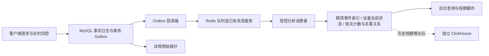

# 风控管理整体性能巡检与改造方案

日期：2026-10-30。结论：先改搜索、分组、分页及返回体积，再将分析数据改为**按新增事件增量维护**。现阶段保留 Laravel 和 MySQL，优先评估独立 Redis 队列与轻量查询投影；长期历史分析再考虑独立 ClickHouse。队列只是调度工具，不会自动降低原 SQL 的成本，不恢复定时全量扫描概览的方案。

本次提交的是巡检工具、实验结果和设计方案，未改业务实现、索引、队列配置或定时任务。现有应用数据库始终通过只读会话查询；写入实验只在独立合成库的回滚事务中进行。未访问阿里云线上实例。

## 1. 测试范围与边界

- 实库：151 类只读场景（主矩阵 146 类，规则/表单入口另 5 类）；主要慢场景另外各重复 3 轮。
- 合成库：53 类台账、名单及规则场景，各重复 3 轮。与实库完全隔离，不复制真实账号或设备数据。
- 覆盖：概览、设备画像/详情/图谱、事件、关联簇、IP 档案/关系/时间线、概率汇总/趋势/应用排行、释放列表/详情、测试账号、策略及旧名单维护只读接口。
- 维度：全局/应用、当天/7/30 天、自定义日期、渠道、版本、4 种决策、4 种等级、事件类型、UUID/IP/版本/风险原因关键词、未命中、组合条件、分页第 100/1000/10000 页和每页 100 条；台账还覆盖 180 天趋势、标签、用户、渠道、未注册等筛选。
- 直接调用路由对应的 Laravel service，测量服务耗时、SQL 耗时、查询次数、EXPLAIN、MySQL handler 读取计数、响应字节数。**不是浏览器端到端、HTTP 鉴权或线上 P95 测试**。响应体字节数通过服务返回值模拟 JSON 序列化测量，该序列化及网络传输不计入服务 wall_ms。
- 查询锚点固定为最新探针数据日 2026-10-29，避免“今天没有数据”产生虚假的快速结论。没有清空 MySQL/操作系统缓存，首轮和后续结果有波动；仅 3 轮的实验报告中位数，不推断 P95。
- 每条 SELECT 的巡检保护上限 5 秒；4 个初测场景被终止。它是单条 SQL 上限，整个接口多条 SQL 累计仍可能超过 5 秒。候选 SQL 实验上限为 15 秒。

### 数据基线

| 数据 | 实库 | 合成库 |
| --- | ---: | ---: |
| 探针日志 | 957,774 | 1 条仅用于完整性水位 |
| 用户 | 304,604 | 1,000 |
| 风控范围 / 收录 | 均 0 | 各 100,000 |
| IP 档案 | 0 | 20,001 |
| 访问 / 时间线 | 均 0 | 各 300,000 |
| 释放 / 关联范围 | 均 0 | 各 20,000 |
| 黑/观察名单 | 0 | 20,000 |
| 上架计划 / 任务 | 33 / 137 | 0，仅实库测试上架监控 |

合成库包含一个具有 10,000 个范围的热点 IP，检验共享出口、详情和分页的放大效应。分布为人为构造，不能线性推算线上百万级延迟。

实库台账 cursor 为空，概率接口返回 `complete=false` 后提前退出。此前日志里这些接口的几毫秒耗时，不能证明其完整统计路径很快。

## 2. 慢查询矩阵摘要

下表“初测”是一次遍历记录，不是稳定分位数；“中位数”来自注明的三轮复测。

| 模块 / 条件 | 实测 | 主要原因 |
| --- | ---: | --- |
| 概览，应用 + 30 天 | 初测单 SQL 超过 5 秒；复测服务中位数 4.64 秒 | 历史过滤 + 设备 MAX(id)，选到设备索引并回表过滤时间 |
| 设备，渠道 | 初测 6.93 秒；复测中位数 4.49 秒 | 分组两次，累计约 191 万次 handler 顺序读取；索引缺少渠道，频繁回表 |
| 设备，应用 + 渠道 / 版本 | 初测 3.48 / 3.53 秒 | 扫历史匹配范围后分组，COUNT 与分页重复 |
| 设备，UUID / IP 关键词 | 初测约 5 秒 | 跨 UUID、安装码、版本、IP、JSON 原因的宽 OR |
| 设备，关键词未命中 | 初测 2.51 秒 | 未命中仍需检查大量历史记录 |
| 事件，UUID / 完整 IP 关键词 | 初测 2.78 / 3.25 秒 | OR 含 `%关键词%`，已有 UUID/IP 索引难发挥作用 |
| 事件，应用 + verify | 初测 2.51 秒；复测中位数 1.57 秒 | 总共只有 46 条匹配，为倒序取 20 条扫描大量不匹配日志 |
| 事件，应用 + 第 10000 页 | 初测 1.78 秒 | OFFSET 199980、宽字段读取及 filesort；约 236 万次 handler 读取 |
| 事件，普通渠道/版本/类型 | 初测约 1.06～1.50 秒 | 精确 COUNT 和过滤扫描占主要开销 |
| 关联簇，全局 | 初测 1.23 秒 | 多账号 + IP DISTINCT 聚合、排序和账号样本；关键词在候选生成后才过滤 |
| 设备详情 / 图谱 | 初测约 0.3～9 毫秒 | 当前样本已能走身份/IP 索引，优先级低 |
| IP 档案按应用 / 未命中词，合成库 | 中位数 251 / 437 毫秒 | 多次相关 EXISTS、重复筛选计数、每次重查筛选选项 |
| 热点 IP 详情，合成库 | 中位数 313 毫秒；JSON 约 5.05 MB | 未分页地读取所有设备、账号、范围，PHP 组装开销明显 |
| 热点 IP 设备关系，合成库 | 中位数 322 毫秒，最终仅返回 20 条 | `relations()` 先构建完整 detail，包含无关关系和所有范围，再 PHP 截取 |
| 180 天应用排行，合成库 | 中位数 286 毫秒 | 多个 DISTINCT、分组排序；数据量继续增长后会线性增加负担 |
| 释放记录组合筛选，合成库 | 中位数 129 毫秒 | 多次关联范围 EXISTS；目前不是最紧急瓶颈 |
| 旧黑/观察名单，合成库 2 万行 | 常规约 3 毫秒；包含搜索约 11 毫秒 | 当前规模可用，无需优先引入搜索引擎 |
| 上架监控 30/180/365 天 | 初测约 27～57 毫秒 | 存在截断，不能据此认定历史数据完整且性能达标 |

JSON/CSV 逐项结果在 `docs/performance/`；单个场景的 `top_sql` 含未展开绑定参数的 SQL 和 EXPLAIN，便于逐项复查。handler 计数是存储引擎操作数，不等同于独立行数或物理磁盘读取量。内存字段是 PHP 进程累计峰值，不能当作单场景新增内存。

## 3. 已做对照实验的低成本改法

没有新增索引或修改业务代码，只在独立实验脚本里改写查询。

| 实验，毫秒 | 原查询 | 候选查询 | 一致性与限制 |
| --- | ---: | ---: | --- |
| 应用 30 天，分组返回设备 ID 阶段 | 2544，单次 | 448，3 轮中位数 | 相同过滤/分组，改用现有 `rpl_app_time_agg`；完整 ID 集合一致。不是整个概览耗时 |
| 同条件 COUNT + 分页分组 | 832 | 433 | 使用窗口函数只分组一次；总数、第一页 ID 一致。越界空页需兜底计数 |
| UUID 关键词 COUNT | 1247 | 0.85 | 候选为显式 UUID 搜索，不是原万能搜索的等价替换 |
| IP 关键词 COUNT | 1232 | 0.76 | 候选为显式 IP 精确搜索，不保留原跨字段包含语义 |
| verify 事件取 20 条展示记录，不含总数 | 1415 | 158 | 先从现有覆盖索引取 ID，再读取当前页字段，ID/顺序一致 |
| 深页取 20 条展示记录，不含总数 | 1400 | 2.14 | 使用上一页游标，记录一致。游标边界的准备不计时，不支持直接跳到任意第 10000 页 |

这些数字来自不同子查询范围，不能拼接成“整个接口已经降到 1 毫秒”的结论，也不是线上性能承诺。

可立即实施的改造清单：

1. **搜索明确类型**：新增“设备 UUID / 安装码 / 完整 IP / IP 前缀 / 精确版本 / 风险标签”条件。原万能搜索作为兼容入口保留，避免用户搜索语义悄悄变化。原因条件改为结构化成员查询；版本包含搜索不能直接换成等号。
2. **日期分组选择合适索引**：当前 `snapshotIndex()` 遇时间等条件返回 null 后，优化器部分场景错选设备索引。用已有索引验证日期范围/选择性，必要时局部 hint；同时核对统计信息，不对所有条件统一 FORCE 一个索引。
3. **避免重复 GROUP BY**：窗口分页或分组结果一次生成轻量 ID 集合；依据结果规模选择。窗口仍需处理全部匹配分组，并不能替代长期数据投影。
4. **事件先 ID 后字段、游标分页**：过滤、排序时只读取必需列，最终才读取展示字段。跳页保留有范围限制的 OFFSET；大规模导出走异步导出任务。
5. **COUNT 与列表分离**：分页先展示结果和 has_more，总数按需或单独加载；如采用短 TTL 缓存，标明统计时点，不返回虚构精确数。需要前端协议配套，不能直接删掉 count。
6. **IP 详情与关系真正 SQL 分页**：`relations(kind)` 只查该类关系，不再调用完整 detail。详情默认概要，其他范围/关系按需加载；列表用已有 `device_count/account_count`，去掉为计数而生成的空占位数组。
7. **筛选选项独立接口与版本缓存**：应用名、渠道、原因目录、distinct 选项不与每次档案列表查询重复执行。现有合成库仅目录 distinct 查询就可占数十毫秒。
8. **前端减少请求扇出**：上架监控页面还按应用拉版本计划、3 个 worker 并发。可批量按 app_id 查询并复用 board 的计划信息；重复点击取消旧请求并做输入防抖。
9. **统一限流/分页约束**：旧 RiskController 服务使用 getPageValue，未像 RiskLedgerController 一样将 limit 上限约束到 100。统一合理上限，防止一次误查返回过多记录。

MySQL 官方说明前导通配符无法利用普通范围扫描；因此加更多普通索引不能消除所有 `%内容%` 搜索。[MySQL 范围优化](https://dev.mysql.com/doc/refman/8.4/en/range-optimization.html)。游标分页的可用场景和跳页限制见 [Laravel 10 分页](https://laravel.com/docs/10.x/pagination#cursor-pagination)。

## 4. 先处理完整性，避免“更快但漏查”

### 已复现

- **IP 档案风险标签**：`tags LIKE '%"code":"root"%'` 依赖 JSON 文本的空格格式。合成库中 20,001 个档案都含 root，现接口却返回 0；JSON 成员查询返回 20,001。应使用结构化 JSON 查询，长期迁移到原因关系表。
- **完整 IP 搜索**：IP 档案对规范 IP 同时保留包含匹配和关联范围 contains。合成库搜 `198.18.0.1` 返回 111 个档案，IP 等号只应匹配 1 个。应明确规范 IP 精确、片段搜索另设类型；设备/账号搜索也显式区分。
- **上架监控截断完整性**：实库 2026-09-30～2026-10-29 有 726,876 条符合源条件的日志；先 LIMIT 5000，再 PHP 筛选出 437 条事件，接口仍返回 `complete=true`。应至少使用源截断标记与 next_cursor；更合理的是将可索引条件前移，真正分页。不能把 LIMIT 截断当成性能优化完成。

### 改造必须保留的口径

- 设备列表当前是**先过滤历史日志，再取每设备 MAX(id)**。旧高风险记录后又恢复正常时，筛选高风险仍可能返回旧记录。单独“最新设备状态表”不能无声替代这种历史匹配语义。
- 无应用筛选的设备按身份全局去重，不能把各应用设备数量直接相加。跨应用共享身份需明确定义，保持现有比较规则。
- 七天/跨天设备和 IP 去重不能简单累加每天的 DISTINCT 数字；要保留唯一关系或可合并的精确去重状态。
- 农场默认窗口是“当前日往前 7 天的零点开始”，与趋势的 7 个日期并非同一边界，迁移时不能混用。
- 释放、撤销、重新收录是有状态变更，不能只做追加计数。需要反向事件/版本化状态；同 IP 多范围并发变化需要串行化或 IP 级锁。
- 台账未追平时当前部分接口返回 complete=false。异步改造需独立的消费水位和覆盖起点，不能仅看到任务队列空或 MAX(id) 相等就声称完整。

## 5. 建议的目标架构



### 事实与查询模型分离

| 模型 | 内容 / 访问方式 | 需要注意 |
| --- | --- | --- |
| 事实日志 | 原始评分、审计与大 JSON；按 ID 读取详情 | 不再承担所有自由筛选、图谱、统计索引。保留可追溯事实 |
| 精简事件索引 | log_id、时间、应用、设备键、IP 键、版本/渠道、评分/决策 | 保存完整历史搜索语义；不重复复制 probe_json/behavior_json |
| 设备当前状态 | 每应用设备及全局设备的最新 log_id 与必要状态 | 适合默认概览/当前画像；历史条件仍查精简事件索引 |
| 原因关系 | log_id/scope_id + reason_code | 索引固定原因成员，避免对大 JSON 做 contains |
| 日访问计数 | 日、应用、决策、请求数量 | 请求数可相加，设备/IP 去重数不可直接相加 |
| 日设备/IP 关系 | 日、应用、IP、设备的唯一组合及最后时间等 | 支持精确滚动窗口；重试与过期应更新去重关系/引用计数 |
| 档案关系投影 | IP 与应用/设备/账号/原因的精简关系及计数 | 避免每次风险命中或详情都扫描同 IP 的所有范围 |

设备/IP 可以使用字典 ID 减少在日志多组索引中重复存储长字符串；字典必须保留完整原值和现有比较规则，不能用可能冲突的短 hash 直接当身份。投影建立后才逐步移除事实表分析索引，验收的是**事实表 + 投影 + 队列 + 缓存的总存储**，不是仅比较单表索引大小。

### 增量消费，而非定时重算

- 探针落库与 Outbox 事件在同一事务中提交。消费者拿到 event_id/source_log_id，按唯一键幂等更新分析投影；完成持久化后才确认消费。失败重试不会重复计数。
- 当前状态以原有 source_log_id/业务版本判断新旧，不按消息到达顺序覆盖；必要时按应用/设备/IP 分区串行消费。不能假设多 worker 与重试天然保持顺序。
- 队列提交与业务提交之间存在故障窗口；`afterCommit` 能避免读到未提交数据，但不能替代可靠 Outbox。投递器只查询待投递增量，不扫描整个风险历史表。[Laravel 队列事务说明](https://laravel.com/docs/10.x/queues#jobs-and-database-transactions)、[Debezium Outbox](https://debezium.io/documentation/reference/stable/transformations/outbox-event-router.html)。
- 每批合并相同 IP 的统计更新，避免每条风险日志都执行完整 refreshDossier。合成热点 IP 的同步 applyLog 测试约 52～72 毫秒、13 条 SQL；安静请求约 3 毫秒、5 条 SQL。该实验是隔离库回滚事务中的台账部分，不是完整客户端请求耗时。
- **实时评分和禁止/释放决策不依赖有延迟的分析投影或可淘汰缓存。** 若现有 risk_scopes 参与释放阻断，应先拆清安全状态与展示聚合，再异步化展示部分；不能直接把整个 applyLog 丢进队列就算完成。
- 记录 source coverage、持久化水位、最老待处理事件时间、重试和死信。初次回填只进行一次，按主键分批且限制资源，追平后持续增量；历史已被日志保留策略清除的范围不能伪装为完整历史。
- 清理日志、投影与关系引用必须协调，避免事实先删除而未被消费；队列故障时由 Outbox 重投补偿。

### 缓存的适用范围

优先缓存应用/渠道目录、筛选选项和重复的 COUNT；之后才考虑短期缓存同条件统计。使用规范化条件、应用/权限范围、业务日期/时区、统计版本组成键，设置容量上限、TTL 抖动和单请求重建锁。展示 snapshot_at / complete / lag，失效时不把未知写成 0。

队列数据和可淘汰查询缓存应使用独立 Redis 实例/进程或外置服务，不能仅靠不同 DB 编号隔离内存与淘汰策略。队列需要合适的持久化、备份和容量告警；缓存的 LRU 淘汰不应导致任务丢失。[Redis 淘汰策略](https://redis.io/docs/latest/develop/reference/eviction/)、[Redis 持久化](https://redis.io/docs/latest/operate/oss_and_stack/management/persistence/)。

## 6. 三方技术选择与资源成本

| 方案 | 当前建议 | 收益与代价 |
| --- | --- | --- |
| 现有 MySQL + 查询重写 | 第一阶段先做 | 已有实验收益，无新服务。历史数据增长后仍需投影 |
| 外置/托管 Redis + Laravel Queue/Horizon | 首选增量方案 | 与现有 PHP/Laravel 接入较少；需要 Outbox、幂等、监控、恢复。不能只修改 QUEUE_CONNECTION |
| RabbitMQ | 有现成消息平台或明确可靠投递需求时可选 | 发布确认、消费确认等能力；仍需 Outbox 和幂等，增加代理/运维，不会加速 SQL |
| MySQL 只读副本 / 独立报表库 | 读写争用明显时采用 | 将管理查询从业务主库隔离；复制延迟必须显示，不承载强一致处置判断 |
| 独立 ClickHouse | 长历史、高并发聚合经容量测试确认后 | 适合列式分析和增量聚合；需同步链路、精确去重、撤销补偿与维护预算 |
| OpenSearch / Elasticsearch | 仅真正需要跨文本模糊检索时 | 对 UUID、IP 和十几种原因标签通常过重；独立部署，不堆在现有小主机 |
| Kafka + Debezium | 多下游、重放与 CDC 需求成型后 | 降低应用双写耦合，支持多分析下游；部署与恢复复杂度更高 |
| 重写 Laravel 为 Go/Rust 等 | 当前不优先 | 主要慢场景 SQL 占耗时绝大部分；换语言不会减少扫描。详情 PHP 组装开销先通过真正分页解决 |

当前实库 `QUEUE_CONNECTION=sync`、缓存为 file。Redis 队列需要常驻 worker；Horizon 可管理 Redis 队列和进程上限，但选用与现有 Laravel 10 / PHP 8.1 匹配的依赖版本，不能照搬最新版配置。[Laravel 10 Horizon](https://laravel.com/docs/10.x/horizon)。RabbitMQ 的生产者确认与消费者确认也不等同于业务端到端“恰好一次”，仍应幂等。[RabbitMQ 确认机制](https://www.rabbitmq.com/docs/confirms)。

ClickHouse 的增量物化视图由新插入数据驱动，并非周期性重新计算全历史；源表更新/删除不能假定自动回算已有聚合。释放撤销要显式补偿，人数/IP 去重按精确集合或精确聚合状态验收，不能悄悄换成近似值。[ClickHouse 增量物化视图](https://clickhouse.com/docs/concepts/features/materialized-views/incremental-materialized-view)。

## 7. 针对 2 核 8 GB 的执行顺序

### 阶段 A：不引入新服务

修复完整性问题；明确搜索类型；局部索引选择与一次分组；事件先 ID 后字段；IP 关系 SQL 分页；COUNT/选项分离；上架监控返回截断/游标并减少前端请求。先对照相同过滤结果、边界与排序，再上线观察。

本机 `innodb_buffer_pool_size` 只有 **128 MiB**，临时表内存阈值为 16 MiB，而事实数据和索引数 GB。它可能放大回表与缓冲波动，需先采集阿里云真实配置、buffer pool 读取、磁盘时延和 PHP-FPM 总内存。不能把本机配置当成线上配置。若 MySQL 与 PHP 同机，可评估 2～3 GiB 缓冲池作为测试起点，结合 PHP 子进程、系统余量与实际峰值调整，不能直接照搬独占数据库的内存比例。

### 阶段 B：增量分析数据

先建立精简事件索引、设备状态与必要去重关系，旁路消费并与旧查询持续对账。业务安全状态保持同步。优先外置 Redis，消费者从 1 个进程起步，批量/限速，根据实际进入速率与积压调整；进程多并不代表更快，不能与主库争用全部 CPU。

初次回填安排专门窗口。增量能力以“进入速率、持续消费速率、最老事件延迟、重试与恢复时间”验收，而不是固定每分钟跑完多少全表 SQL。

### 阶段 C：迁移读路径与索引

按接口逐个切到投影，影子对账通过后再删原分析索引；保留回退开关、重建版本、读取水位。事实表保留按 ID 详情和清理所需的少量索引，具体清单以迁移后的访问路径决定，本轮不删除索引。

长保留原始 JSON 可评估对象存储/冷数据表。分区需单独设计：当前按 ID 主键、30/90 天不同保留策略以及所有关联/游标，不适合直接套一个日期分区 ALTER。

### 阶段 D：是否外置历史分析

只有在真实压测中，精简模型与增量维护仍不能达到目标，才部署独立 ClickHouse/报表副本；若要上搜索引擎也独立部署。不要把 MySQL、PHP、Redis、多 worker、ClickHouse 和搜索引擎同时塞进当前 2 核 8 GB 主机。

## 8. 验收标准与发布控制

- 正确性：过滤后取最新与当前状态语义分别验收；完整 IP/版本/原因、同设备跨应用、重复/乱序事件、迟到事件、跨日、过期删除、释放→撤销→重收录、空页/深页及原始明细可追溯。
- 对账：相同截止水位，旧新结果逐项比较；精确 count/distinct 必须一致。显示明确的数据覆盖起点、时效与不完整标记。
- 故障：提交后投递中断、消息重复、consumer 崩溃、Redis 重启、死信重放、Outbox 积压和历史回填并行。
- 容量：预发布用接近线上数据体积，在客户端写入背景负载下测试管理查询；记录 P50/P95/P99、主库 CPU、IO、锁等待、buffer pool、队列延迟、查询扫描/返回比和总存储。
- 建议目标（待线上基线确认）：有范围的列表 P95 < 500ms，分析概览 P95 < 1s；宽历史或全量导出显式异步。不能将本机实验数字当作已达到这些目标。
- 每个阶段独立开关；新投影只旁路写入期间仍保留旧查询。容量和对账通过后按应用/接口灰度，再讨论删索引及历史迁移。

## 9. 工具与结果文件

- `tools/risk-performance-audit.php`：只读矩阵，输出脱敏 SQL/EXPLAIN 和 CSV；默认单条查询 5 秒保护。
- `tools/risk-performance-experiments.php`：现有索引、窗口分页、显式关键词及游标的对照实验。
- `tools/risk-performance-fixture.php`：仅允许本机 MySQL，创建/删除随机名称的隔离合成库；只复制必要表结构，创建测试数据。
- `tools/risk-performance-fixture-checks.php`：仅对隔离库验证 JSON/IP 结果和回滚事务中的同步写入。
- `docs/performance/risk-2026-10-30-real.{json,csv}`、`catalog.{json,csv}`、`targeted.{json,csv}`：现有数据与重点复测。
- `docs/performance/risk-2026-10-30-fixture.{json,csv}`：有数据台账的三轮结果。
- `docs/performance/risk-2026-10-30-experiments.json`、`fixture-checks.json`、`publishing-cap.json`、`mysql-settings.json`、`log-summary.json`：对照实验、结果完整性、配置与历史 SQL 日志汇总。

复测示例（默认读取当前项目配置，实际运行前核对连接目标及业务负载；合成库工具限本机）：

```bash
php tools/risk-performance-audit.php --output=/tmp/risk-real --timeout-ms=5000
php tools/risk-performance-audit.php --only=device.channel,event.app.decision.verify --repeat=3 --output=/tmp/risk-targeted
php tools/risk-performance-experiments.php --output=/tmp/risk-experiments.json
php tools/risk-performance-fixture.php --create
# 将下面名称替换为 create 命令输出的随机隔离库名
php tools/risk-performance-audit.php --database=risk_perf_fixture_012345abcdef --only=probability,dossier,release,monitor,lists --repeat=3 --output=/tmp/risk-fixture
php tools/risk-performance-fixture-checks.php --database=risk_perf_fixture_012345abcdef --output=/tmp/risk-fixture-checks.json
php tools/risk-performance-fixture.php --drop=risk_perf_fixture_012345abcdef
```

历史日志统计是每条 SQL 的耗时，不是接口总耗时，也可能早于本轮代码；本轮决定优先级以当前源码实测和等价实验为主。隔离测试库在本次巡检结束后删除，业务表/索引/配置保持原状。

## 10. 阶段 A / 第 1 步实施结果（2026-10-30）

已实施前后端查询层改造，未新增/删除索引，未增加定时任务、队列或缓存依赖，未修改风险评分、门禁决策、自动解除及撤销规则。仅在本机验证，尚未部署阿里云。

### 已交付行为

- 设备/事件增加明确的 `keyword_type`：`all` 保留原综合搜索，`device` 按生成的设备标识精确查询、`install` 按安装标识、`ip` 按规范化完整地址、`ip_prefix` 按字面前缀、`version` 按完整版本、`reason` 按 JSON 原因代码。界面显示对应搜索类型与提示，不自动将综合搜索改成精确查询。
- 设备筛选保留“筛选历史后，按设备取 MAX(id)”口径；有条件分页使用一次分组的窗口计数，越界空页单独补精确 count。无条件全局列表保留原来的一次分组快路径。MySQL 5.7 自动使用原来的两次分组分页，避免依赖数据库升级；窗口路径在本机 MySQL 9 验证，5.7 回退未在独立 5.7 实例实测。
- 时间筛选、评分/决策筛选仅在条件被现有索引覆盖时选择相应索引；快照外侧使用设备覆盖索引。矩阵曾发现窗口分页影响决策筛选执行计划，已修正并单独三轮复测。
- 事件先取当前页 ID，再读取该页字段。默认兼容原 `count`；页面请求 `include_count=0`，先显示列表，再调用 `GET risk/event/count`。总数尚未取得时显示“统计中”及前后翻页，不伪造总数；统计失败可重试。
- 事件返回加密校验的 `next_cursor`、`count_cursor`、`has_more`。条件与 ID 截止点绑定，连续页使用 keyset，未知页跳转仍使用原 offset 并保持同一截止点。换条件或篡改游标返回校验错误；新增记录需刷新后进入本轮结果。总数包含截止点内的全部匹配记录，不受当前页游标影响。
- IP 设备/账号关联直接对去重分组做 SQL count/page，排序稳定；不再调用完整详情后在 PHP 截取。页面使用 `compact=1` 的列表、`include_relations=0` 的详情及关系分页接口，保留真实设备/账号数量，去掉占位数组和完整 scopes 传输。旧客户端默认仍可请求原完整详情。
- `GET risk/ip-dossiers/options` 独立提供选项，页面首次加载一次，翻页使用 `include_options=0`。IP 详情按标签页加载并支持 SQL 翻页、事件类别/应用/标签/日期筛选，日历使用独立的完整日聚合，后续事件页不重复请求日聚合。前端防止旧请求覆盖新条件/新 IP 的结果。
- 修复 MySQL 原生 JSON 标签匹配失败，改为 JSON 条件；完整 IP 直接精确查询，片段仍可包含搜索；状态统计与列表总数共用一次统计。
- 上架监控将账号/风险资格条件移至 LIMIT 之前，先 ID 后字段，默认每批 500 条，返回真实 `has_more/next_cursor/complete`；页面可按批继续加载并明确还有数据，去掉旧的逐应用/逐账号加载入口。未将一批数据误标成全部。保留原有“所选测试账号事件，或该应用风险事件”的筛选含义。
- 原风控管理与名单分页限制为 page ≥ 1、limit 1～100，防止异常分页参数拉取无限明细。

### 本机结果

下表为本机 Laravel 服务调用耗时，非 HTTP 全链路，也不代表 2 核云主机时延。三轮场景取中位数，矩阵补测仅一轮；缓冲命中与执行顺序会影响结果。

| 场景 | 原基线 | 本轮 |
| --- | ---: | ---: |
| 设备渠道筛选 | 约 4.49 s | 约 1.43 s |
| 应用近 30 天设备列表 | 原分组实验 2.54 s（不是完整接口） | 完整服务约 0.54 s |
| 应用验证类事件，兼容返回 count | 约 1.58 s | 约 0.32 s |
| 应用验证类设备列表 | 约 0.37 s | 约 0.21 s |
| 应用限制类设备列表 | 约 0.34 s | 约 0.17 s |
| 精确设备 / IP 事件搜索，含 count | 语义更宽的综合搜索约 2～3 s，不能视为等价替换 | 约 4.6 / 4.4 ms |
| 应用事件列表，不含 count | 原实现与 count 串行 | 约 4.1 ms，count 另约 111 ms |
| 连续下一页事件，不含 count | 原 offset 路径 | 约 6.1 ms |
| 热点 IP，1 万设备关系第一页 | 约 322 ms | 约 49 ms |
| 热点 IP，8000 账号关系第一页 | 约 323 ms | 约 32 ms |
| 热点 IP 详情返回大小 | 5,045,682 字节 | 精简详情 687 字节，关系另按页读取 |

完整 IP 原来误匹配 111 个地址，现在准确返回 1 个。JSON `root` 标签原来返回 0，现在返回 20001，与原生参考查询一致。这两项属于已确认的结果修复，不能以原来的错误结果作为等价目标。

151 个查询场景整轮执行无查询错误；能与旧实库基线直接对照的 `result_count` 均一致。该整轮之后对事件取页/计数索引选择及设备决策索引做了局部修正，并以专项三轮和正确性回归验证。完整矩阵中的部分耗时是修正前的中间结果，最终相关耗时以 `step1-query-checks`、`step1-device-decisions` 为准。

### 验证及记录

- SQLite 内存隔离回归 **38 tests / 302 assertions**：原评分与边界、按应用隔离、历史筛选取最新、空页精确 count、字面 IP 前缀、明确搜索、游标换条件/篡改/插入记录、分页 cutoff、IP 关系去重分页、事件分类筛选、5000 多条普通流量不能遮住更早风险事件。
- 隔离 MySQL 合成库验证：IP 设备页 1/2/500/501、账号页 1/2/400/401 均与完整参考集合一致；数量、尾页和空页正确。参考完整详情的对照进程临时使用 `php -d memory_limit=512M`，不改变服务 PHP 内存配置；新页面精简详情不再加载全量关联。
- Vue 行为检查通过：列表先显示、异步精确 count、相邻游标页、快速换搜索/换 IP 的旧响应隔离、精简详情、关联分页。命令：在 `resources/apps-admin` 执行 `node tools/risk-ui-regression.cjs`。
- 本轮 count/options/relations/monitor 等读取路由匹配和控制器方法验证通过。项目全局 `route:list` 被既有的 `OutApiController` 缺失阻断，未将该命令计作通过。
- 修改的前端文件 ESLint 通过；前端生产构建通过。构建仍提示既有资源包体积与 Browserslist 数据过期，未扩大本轮范围修改依赖。
- `docs/performance/risk-2026-10-30-step1-real.{json,csv}`：重点三轮。
- `...-step1-matrix.{json,csv}`：151 场景整轮。
- `...-step1-device-decisions.{json,csv}`：最终设备全局及决策三轮。
- `...-step1-fixture.{json,csv}`：合成数据台账查询三轮。
- `...-step1-fixture-checks.json`：JSON/IP 与同步规则回滚事务验证。
- `...-step1-compact-checks.json`：精简响应与深页/空页集合对照。
- `...-step1-query-checks.json`：最终精确事件搜索、取页、计数、游标对照。
- 新工具 `tools/risk-step1-checks.php` 默认只读实库；`--database` 仅允许本机随机隔离库。合成库在本轮验证完成后已删除。

### 发布和保留限制

前后端需要一同发布，按项目现有流程更新路由缓存与 PHP OPcache；本轮无需迁移、索引 DDL、定时任务或 worker。旧事件列表仍默认携带 count，旧 IP 列表/详情默认保留原格式。上架监控的截断结果改为显式分批，调用者应使用新游标继续读取；本轮页面已接入。

跨月概览仍需精确计算整个区间的 IP→设备去重，应用近 30 天概览约 **2.5～2.6 s**，全局近 30 天约 **3.85 s**。综合 OR / JSON 文本模糊搜索在本轮矩阵仍约 **1.8～1.9 s**；选项首次加载、关系分组精确 count 也并非零成本。旧客户端主动请求完整 IP 详情仍会加载全关联。下一阶段若要继续大幅降低这些耗时，应按阶段 B 做增量投影/去重统计与对账；不恢复定时全量扫描，不把这些慢场景说成已全部解决。
